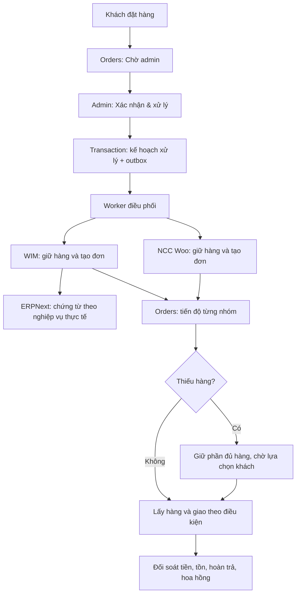

# Thiết kế luồng một nút trong Orders

Ngày 01/11/2026. **Đề xuất triển khai, chưa phải chức năng đã hoàn thành.** Đi cùng [báo cáo](./BAO-CAO.md) và [nghiệm thu](./QA.md).

## 1. Chính sách đã chốt

- Khách bấm Đặt hàng → lưu đơn **Chờ admin xác nhận**. Khách tiếp tục đặt đơn khác bình thường.
- Admin bấm **Xác nhận & xử lý** một lần → hệ thống tự kiểm tra lại, giữ hàng, chuyển đơn theo nguồn và cập nhật tiến độ.
- Một NCC thiếu hàng → giữ phần còn hàng, thông báo khách chọn cách xử lý phần thiếu.
- Cửa hàng theo dõi và xử lý ngoại lệ ngay trong Orders; không phải mở từng website để duyệt cùng một đơn.

Khách đặt hàng chỉ tạo ý định mua và thông báo tiếp nhận. Không gửi đơn NCC, tạo vận đơn hay ghi paid/completed trước khi admin duyệt. Nếu tiền thực tế về sớm, vẫn phải ghi nhận giao dịch; việc có tiền không tự thay thế quyền duyệt đơn.

## 2. Một nút hoạt động thế nào

### Khi admin duyệt

1. Kiểm tra quyền, phiên bản đơn và revision giỏ hàng; khóa hàng đơn trong transaction ngắn.
2. Chốt snapshot gồm dòng hàng, nguồn, số lượng, giá, thuế, phí, giảm giá, tiền tệ và địa chỉ cần thiết. Mỗi dòng có định danh ổn định, không chỉ dùng tên sản phẩm.
3. Ghi `approvedBy/approvedAt`, kế hoạch theo nhóm nguồn và outbox trong cùng transaction. Cùng nút/cùng revision chỉ tạo một lệnh nhờ unique constraint.
4. Trả ngay trạng thái **Đang xử lý**. Không giữ request HTTP chờ hết WIM, Woo và ERP.
5. Worker gọi giao thức nguồn, lưu kết quả từng bước; cập nhật Orders và gửi thông báo qua outbox.

Bấm hai lần hoặc tải lại không tạo đơn nguồn thứ hai. Nếu admin đã duyệt nhưng tồn thay đổi, nguồn quyết định số lượng thực sự giữ được; snapshot hiển thị ở web không phải bằng chứng giữ hàng.

### Khi lỗi hoặc chưa biết kết quả

- Timeout sau POST → **Đang xác minh**, tra cứu bằng command key trước khi kết luận.
- Có giao thức idempotency đã kiểm chứng → retry đúng key/body, tiếp tục giai đoạn còn thiếu.
- NCC chỉ có raw Woo POST → không tự gửi lại mù; nhóm chuyển **Cần đối soát** nếu không xác định được kết quả.
- Hết retry → hàng đợi lỗi có lưu lý do, bước bị lỗi và nút **Thử lại** trong Orders. Nút này tiếp tục command cũ, không tạo command mới.
- Mất kết nối không được tự chuyển thành hết hàng, đã hủy, đã trả tiền hay hoàn tất.

## 3. Ai chịu trách nhiệm dữ liệu

| Dữ liệu | Nguồn có thẩm quyền | Studio giữ gì |
|---|---|---|
| Đơn khách, quyền duyệt, lựa chọn khách | Studio | Đơn tổng, snapshot và lịch sử lệnh |
| Tồn/giữ hàng nguồn WIM | WIM cùng cơ chế kho ERP đã thống nhất | Projection có thời điểm cập nhật, reservation ID |
| Sổ kho/kế toán ERP | Chứng từ ERPNext được submit hợp lệ | Tham chiếu chứng từ và trạng thái xác minh |
| Tồn/giữ hàng của NCC Woo | NCC Woo và endpoint reserve của NCC | Nhóm đơn NCC, reservation và remote order ID |
| Giao dịch ngân hàng/cổng thanh toán | Sự kiện đã xác thực và đối soát nhà cung cấp | Ledger giao dịch, phân bổ vào đơn |
| Hàng giao và tiền COD | Sự kiện kho/đơn vị vận chuyển và bảng đối soát | Trạng thái riêng cho giao hàng, thu COD, COD chuyển về |
| Hoa hồng | Chính sách snapshot + dòng đã đủ điều kiện | Earned/reversed/payable/paid theo dòng |

Không dùng một field `status` để đại diện tất cả nghiệp vụ. Tách ít nhất: duyệt, xử lý nguồn, tồn, thanh toán, giao hàng, công nợ NCC và thông báo. Trạng thái tổng là projection từ các chiều này.

### Giữ hàng khác trừ sổ kho

- Khi xử lý: nguồn giữ hàng nguyên tử, làm giảm **khả dụng để bán**.
- Khi lấy/xuất: task tiêu thụ reservation đã có; không reserve hoặc trừ lần hai.
- ERP ghi nhận kho qua đúng chứng từ nghiệp vụ. Mã local có Sales Invoice `update_stock=1` và các luồng dùng chứng từ kho riêng; phải chọn đúng một cơ chế cho từng luồng, không cộng thêm một lệnh “trừ ERP” tùy ý.
- Hàng NCC giao thẳng không làm giảm tồn kho sở hữu của cửa hàng trong WIM/ERP. Nếu có nghiệp vụ nhập rồi xuất qua kho cửa hàng, cần mô hình mua/nhập/xuất riêng.
- Hủy trước lấy hàng → release reservation. Trả sau giao → nhận hàng trả và chứng từ hoàn/điều chỉnh; không chỉ tăng lại một con số tồn.

## 4. Hợp đồng bắt buộc ở nguồn

Các tên dưới đây là **hợp đồng đề xuất**, không phải endpoint đã có đầy đủ.

| Khả năng | Yêu cầu |
|---|---|
| `capabilities` | Phiên bản contract, tiền tệ, loại hàng, reservation/expiry/partial/cancel/refund được hỗ trợ |
| `ensureOrderAndReserve` | Unique `(tenant/site, commandKey)`; lưu body hash, stage, snapshot và kết quả; giữ tồn nguyên tử với các kênh khác |
| `getCommand` | Lookup trực tiếp theo key, trả in-progress/succeeded/rejected; không quét danh sách hàng nghìn đơn |
| `release/cancel` | Idempotent theo revision, trả số lượng thực sự đã release/hủy; phân biệt đã lấy/đã giao |
| `fulfillment` | Liên kết pick/ship/deliver với reservation và từng dòng |
| `refund/return` | Theo dòng/số lượng/số tiền, có bằng chứng và tham chiếu giao dịch/chứng từ |
| `events` | Event ID, tenant, entity ID, version, thời điểm, loại sự kiện, chữ ký và endpoint đọc lại |

Cùng key nhưng body khác phải bị từ chối. Cùng key/body sau crash phải tiếp tục đến đủ dòng, không trả thành công cho một đơn đang dựng dở. Kết quả phải đối chiếu product/variation/qty/giá/currency và các thành phần tổng tiền.

### WIM/ERPNext

- Bổ sung reservation tại thời điểm nguồn chấp nhận lệnh admin; kiểm thử với đơn quầy và mọi đường bán khác cùng tiêu thụ kho.
- Liên kết reservation với pick task hiện có; không giữ hai lần. Reservation và việc tạo task phải có cơ chế phục hồi sau crash.
- Sửa resume đơn web theo stage, số dòng và fingerprint; bổ sung reverse projection vào đơn Shop.
- Có adapter command cho các bước WIM/ERP. Quyền tự động có scope theo site/kho/nghiệp vụ; không dùng tài khoản Administrator dùng chung.
- Thiết kế kênh online/ca hệ thống nếu cần để không phụ thuộc người mở ca quầy. Cách hạch toán, POS profile và thời điểm chứng từ phải được nghiệm thu với ERP thực tế.

### WordPress/WooCommerce của NCC

- Cần endpoint supplier ensure/reserve được cài ở phía NCC. Unique command phải được bảo đảm bằng DB và cơ chế tồn của Woo, không chỉ lưu order meta.
- Giữ hàng phải cạnh tranh đúng với khách mua trực tiếp tại Woo; kiểm thử cả expiry, cancel, payment và mọi plugin tồn đang bật.
- Raw `pending` order và `set_paid:false` hiện tại không đủ để cam kết giữ tồn toàn hệ thống. Không giả `set_paid:true` để ép giảm tồn.
- Hosso Connector local đang phục vụ chiều **WordPress bán hàng Hosso**; không suy rằng nó đã cung cấp contract cho chiều **Studio mua hàng NCC Woo**.
- NCC cũ chưa hỗ trợ contract được gắn nhãn rõ và chuyển vào ngoại lệ trong Orders. Chỉ bật xử lý hoàn toàn tự động cho NCC đã qua capability/contract gate.

## 5. Thiếu một phần hàng

Mỗi dòng lưu `ordered/accepted/reserved/fulfilled/cancelled/returned/refunded` thay vì chỉ trạng thái nguyên đơn. Nguồn có thể trả số lượng chấp nhận ít hơn số đặt theo khả năng contract.

1. Giữ phần có hàng; nhóm thiếu có lý do riêng. Không tự hủy phần đã giữ thành công.
2. Thông báo khách: phần có hàng, phần thiếu, thời hạn giữ và ảnh hưởng đến phí/tổng tiền.
3. Khách chọn **nhận phần có hàng**, **chờ bổ sung** nếu NCC có cam kết phù hợp, hoặc **yêu cầu hủy**. Không tự thay SKU hoặc tăng giá.
4. Tạo revision được khách chấp thuận; phân bổ lại giảm giá/phí/tiền đã nhận. Khoản phải hoàn được tạo thành công việc có theo dõi, không ghi đã hoàn trước khi có bằng chứng.
5. Chỉ giao phần có hàng khi đã có quyết định khách phù hợp. Hết hạn chờ → giải phóng phần chưa thực hiện theo chính sách, thông báo và đưa Orders vào xử lý ngoại lệ nếu có tiền/hàng đang đi.

**Cấu hình còn cần chọn khi triển khai:** thời gian giữ hàng, số lần gia hạn, thời gian chờ khách, điều kiện giao tách và cách tính lại phí. Đề xuất khởi đầu TTL giữ 30 phút, có giới hạn gia hạn và cấu hình theo NCC; đây chưa phải chính sách chủ hệ thống đã duyệt. Không expire phần đã pick/ship như hàng đang giữ thông thường.

Nếu giá nguồn tăng sau khách đặt, đơn chuyển chờ quyết định; không tự tăng số phải thu. Trong lúc chưa chốt giá/thay đổi, không phát lệnh không thể đảo ngược.

## 6. Tiền, giao hàng, hoa hồng và email

- Mỗi giao dịch tiền là một dòng ledger, unique theo provider + transaction ID. 60k + 40k phải phân bổ thành 100k; duplicate không cộng lần hai. Tiền chưa khớp vào hàng đợi đối soát.
- Tách `customerPaid`, `supplierPayable`, `supplierSettled`, `codCollected`, `codRemitted`; đơn paid không có nghĩa NCC đã được trả hoặc cửa hàng đã nhận COD.
- Tạo shipment sau khi nhóm được duyệt, xác nhận đủ điều kiện và phương án giao đã chốt. Có command key, lookup và xử lý timeout trước khi thử lại.
- Delivered không tự chứng minh COD đã chuyển về. Kho/nhà vận chuyển vẫn cung cấp sự kiện vật lý thực; admin chỉ xác nhận ngoại lệ tại Orders nếu thiếu tích hợp.
- Hoàn một dòng chỉ đảo phần tiền/tồn/hoa hồng của dòng đó. Hoa hồng trả rồi cần khoản điều chỉnh để đối soát, không xóa lịch sử.
- Nếu áp chính sách affiliate đã chốt trước đó: lưu snapshot mức 15%, lịch cuối tháng, tối thiểu rút 100k và quyền chi ngoài kỳ. Cơ sở tính hoa hồng và điều kiện đủ trả cần được thể hiện trong policy; không mặc định 15% trên mọi khoản thu gồm phí/thuế.
- Email tiếng Việt, giao diện thống nhất: tiếp nhận → kết quả xử lý/thiếu hàng → giao hàng → hoàn trả khi có. Không hiển thị mã bảo mật đơn hàng. Thao tác khách dùng phiên đăng nhập hoặc liên kết quyết định ngẫu nhiên, ngắn hạn, giới hạn đúng đơn/hành động; không dùng 4 số điện thoại làm quyền truy cập.
- Gửi email có outbox và chống trùng theo event; lỗi gửi không làm mất đơn hoặc đảo trạng thái tiền. Khách vẫn xem được tiến độ trên trang đơn hàng.

## 7. Điều phối bền vững

Tận dụng DB, hệ thống jobs và adapter hiện có. Chưa có bằng chứng cần thay bằng một nền tảng workflow lớn.

- Transaction đơn + command + outbox; worker dùng lease có fencing token để worker cũ không ghi đè worker mới.
- Inbox unique `(source, tenant, eventId)` trước khi xử lý webhook. Bỏ qua trùng; sự kiện cũ không làm lùi trạng thái. Mất thứ tự thì đọc lại nguồn có version.
- Mỗi consumer có ack riêng. Payment paid và outbox phải commit cùng nhau; lỗi consumer còn công việc để retry.
- Retry exponential backoff có jitter, timeout và giới hạn concurrency theo NCC. Không gọi mạng ngoài trong transaction/hook sửa đơn.
- Không tuyên bố exactly-once HTTP. Dùng giao nhận ít nhất một lần, unique key và tác dụng phụ idempotent tại nguồn.
- Saga có bước bù trừ rõ ràng: release/hủy/hoàn; nếu không đảo được thì ghi ngoại lệ có chứng cứ. Không xóa đơn để che kết quả dở dang.
- Đối soát định kỳ độc lập webhook cho đơn đang xử lý, giao dịch tiền, reservation hết hạn và thay đổi hậu hoàn tất.
- Metric: tuổi lệnh chờ, thời gian xử lý, nhóm unknown, tồn giữ quá hạn, lệch tiền/tồn, webhook chưa xử lý và số lần retry. Log chứa correlation ID, không chứa secret/PII không cần thiết.

## 8. Orders và quyền truy cập

Màn chi tiết hiển thị: trạng thái tổng, thanh toán, nhóm WIM/NCC, phần thiếu, dòng thời gian và lỗi có hướng xử lý. Admin không phải đọc tên API hay stack trace để biết bước tiếp theo.

| Thao tác | Quy tắc server |
|---|---|
| Xác nhận & xử lý | Quyền vận hành, expectedVersion, idempotency key |
| Thử lại bước lỗi | Cùng command; chỉ trạng thái retryable; có audit |
| Hủy/hoàn/điều chỉnh | Quyền theo nghiệp vụ và giới hạn tiền; kiểm tra trạng thái nguồn |
| Xác nhận tiền thủ công | Quyền tài chính riêng, lý do/chứng từ; không sửa `paidAmount` trực tiếp |
| Sửa nội dung sản phẩm | Publisher không có quyền ghi tiền, duyệt, lịch sử hay xóa đơn |

Khoá trường hệ thống ở API/hook, không chỉ `admin.readOnly`. Mọi command lưu actor, thời điểm, version, request hash và kết quả; lịch sử không sửa/xóa qua CRUD thông thường.

Secret mã hóa/mask; tách inbound/outbound và quyền đọc/ghi; chặn redirect mang credential; allowlist đích và egress. Webhook/token truy cập có scope, chống replay và kiểm tra tenant. Dữ liệu địa chỉ chỉ chuyển cho bên thực sự giao hàng.

Các khối editor cần cấu hình được từ schema dùng chung: giỏ hàng, checkout, kết quả đơn và tra cứu đơn. Logic command/quyền/giá/tồn luôn ở server; không sửa riêng một trang bằng HTML để giả chức năng thương mại.

## 9. Lộ trình theo repo và cổng nghiệm thu

| Đợt | Nơi sửa chính | Kết quả phải chứng minh |
|---|---|---|
| 1. Đóng lỗi nền | Studio/private `plugin-cross-sell` auth/credentials/remote; `plugin-shop` collections/operations; `plugin-wim` client; `plugin-payment` và event persistence | S01–S05, S03, F07, F10–F11 chuyển thành regression xanh; không lộ key/đổi tiền trái quyền/mất giao dịch |
| 2. Contract nguồn | WIM `public-api.service`, repository/reservation/picking; ERP API; supplier Woo connector mới hoặc mở rộng đúng chiều | F03–F05 được sửa; tồn cạnh tranh mọi kênh; crash resume đủ dòng; unique key/hash tại nguồn |
| 3. Điều phối và Orders | Studio checkout/operations, collections command/outbox/inbox, jobs, màn Orders, notify | Không gửi trước duyệt; double-click một kết quả; nhóm thiếu giữ đúng policy; worker restart không mất bước |
| 4. Khép vòng | WIM/ERP payment/fulfillment, Woo partial refund, shipping, affiliate | Đúng sổ tiền/kho/COD/hoa hồng; hủy/hoàn từng phần có bù trừ và đối soát |
| 5. Phát hành | CI liên repo, staging có Woo/ERP thật, migration/capability/release manifest | Ma trận QA qua; rolling upgrade/rollback không tạo trùng; bật theo site/NCC có capability |

Private plugin là nơi sửa canonical; mirror Studio đồng bộ có kiểm tra hash, tránh hai bản logic khác nhau. Các collection/field mới phải có migration và index; backfill đơn cũ theo trạng thái đã xác minh, không tự gửi lại toàn bộ pending cũ.

Triển khai additive schema trước, feature flag mặc định tắt; nâng adapter/capability rồi mới worker và UI. Rollback dừng phát lệnh mới, giữ ledger/outbox và cho phép reconcile; không rollback dữ liệu để xóa tác dụng phụ đã xảy ra ở nguồn.

**Nghiệm thu cuối:** admin duyệt một lần, sau đó mọi bước phần mềm có đủ bằng chứng được tự chạy; bước vật lý và tiền thật đến từ nguồn có thẩm quyền. Nếu có ngoại lệ, admin xử lý tại Orders, có lịch sử và không cần duyệt lặp lại ở từng website.
